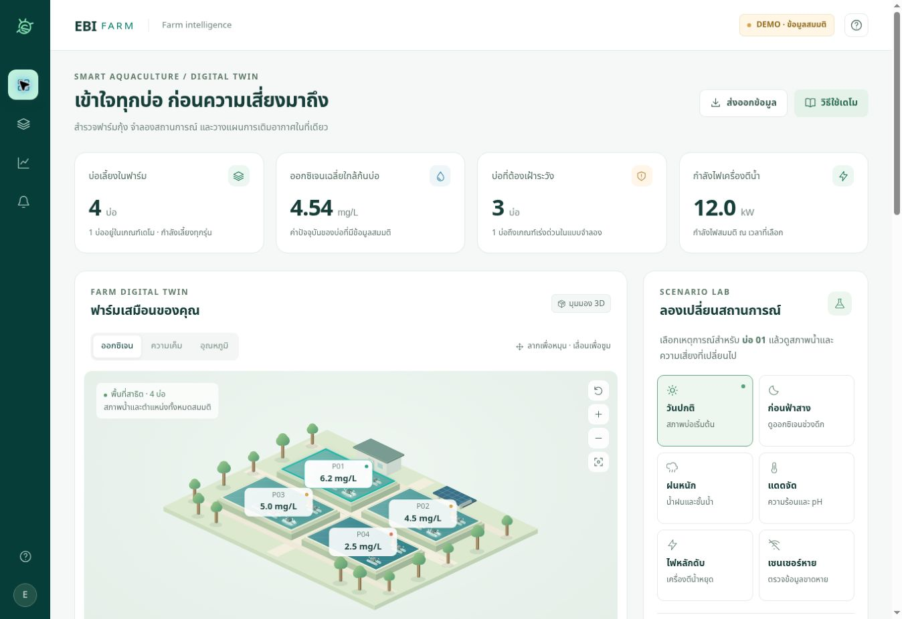

# EBI Farm

**เดโม Digital Twin ฟาร์มกุ้ง — ดูสภาพบ่อ จำลองความเสี่ยง และเปรียบเทียบทางเลือกก่อนตัดสินใจ**

EBI Farm เป็นเว็บเดโมภาษาไทยที่จำลองฟาร์มกุ้ง 4 บ่อ พร้อมสภาพอากาศ คุณภาพน้ำ และการทำงานของเครื่องเพิ่มอากาศ ผู้ใช้เลือกสถานการณ์แล้วเปรียบเทียบแนวโน้มออกซิเจนละลายน้ำ (DO) ในอีก 3 ชั่วโมง ระหว่างการเดินระบบเดิมกับแผนที่ปรับเองได้

> ทุกบ่อ ทุกค่า ทุกเหตุการณ์ และทุกการพยากรณ์ในแอปเป็นข้อมูลสมมติสำหรับสาธิต ไม่มีการเชื่อมต่อเซ็นเซอร์หรือสั่งอุปกรณ์จริง ผลลัพธ์ไม่ใช่ความน่าจะเป็นที่กุ้งจะตาย และไม่ใช้วินิจฉัยโรคกุ้ง

**เปิดเดโมที่เผยแพร่แล้ว:** [EBI Farm Demo](https://ebi-farm-demo.gon1122.chatgpt.site/)

เดโมบน Sites ตั้งสิทธิ์ให้เจ้าของบัญชีเข้าดูผ่าน **Continue with ChatGPT** ยังไม่ใช่ลิงก์สาธารณะ การเผยแพร่ครั้งนี้ใช้โค้ด commit `55359d7` และไม่ผูกการ deploy อัตโนมัติกับการ push GitHub รายละเอียดอยู่ใน [บันทึกการเผยแพร่](docs/deployment.md)



[ตัวอย่างกราฟบนหน้าจอมือถือ](docs/screenshots/mobile.jpg) · [บันทึกการตรวจเดโม](docs/verification.md)

## เริ่มใช้งาน

โปรเจกต์ใช้ HTML, CSS และ JavaScript แบบ ES modules โดยไม่มี dependency ภายนอกสำหรับตัวแอป ไม่ต้องติดตั้งแพ็กเกจก่อนเปิดเดโม แต่ต้องมี **Node.js 20 ขึ้นไป** และ npm สำหรับรันคำสั่งของโครงการ

```bash
npm run dev
```

เปิด <http://127.0.0.1:5173> ในเบราว์เซอร์ ค่าเริ่มต้นรับการเชื่อมต่อจากเครื่องที่รันเท่านั้น

หากต้องการเปลี่ยน host หรือ port ให้กำหนด `HOST` และ `PORT` ก่อนเริ่มเซิร์ฟเวอร์ ตัวอย่าง Bash:

```bash
HOST=127.0.0.1 PORT=5174 npm run dev
```

ตัวอย่าง PowerShell บน Windows:

```powershell
$env:HOST = "127.0.0.1"
$env:PORT = "5174"
npm run dev
```

## ลองเดโมอย่างไร

1. **เลือกบ่อ** จากภาพฟาร์มหรือปุ่มเลือกบ่อ เพื่อดูค่าของบ่อนั้น ลากบนภาพเพื่อหมุนมุมมอง และใช้ล้อเมาส์เพื่อซูม
2. **เปลี่ยนชั้นข้อมูล** ระหว่างออกซิเจน ความเค็ม และอุณหภูมิ เพื่อเปรียบเทียบตำแหน่งที่ควรติดตาม
3. **เลือกสถานการณ์** แล้วดูว่าคุณภาพน้ำ แนวโน้ม DO และการแจ้งเตือนเปลี่ยนอย่างไร
4. **ปรับแผนรับมือ** ด้วยจำนวนเครื่องเพิ่มอากาศ ปริมาณอาหารเทียบแผนเดิม และไฟสำรอง จากนั้นกด **“จำลองแผนนี้”** แล้วเปรียบเทียบเส้นแนวโน้ม 3 ชั่วโมงกับกรณีเดินระบบเดิม จำนวนเครื่องที่เลือกคือจำนวนรวมในแผน ไม่ใช่จำนวนที่เพิ่มจากเดิม
5. **เดินเวลาจำลองหรือรีเซ็ต** เพื่อดูการเปลี่ยนแปลงตามเวลา รับทราบการแจ้งเตือน และส่งออก CSV เมื่อต้องการตรวจข้อมูลต่อ

บนกราฟ สามารถเลื่อนเมาส์ดูรายละเอียดแต่ละช่วงเวลา หรือโฟกัสกราฟแล้วใช้ปุ่มลูกศรซ้าย–ขวาได้

สถานการณ์และเวลาจำลองแยกกันในแต่ละบ่อ การเดินเวลาหรือรีเซ็ตมีผลเฉพาะบ่อที่เลือก เมื่อสลับบ่อ ระบบจำสถานการณ์และเวลาของบ่อนั้น แต่ตั้งแผนทดลองใหม่ตามการเดินเครื่องเริ่มต้นของบ่อ จึงควรส่งออกผลก่อนหากต้องการเก็บแผนที่เพิ่งทดลองไว้

### สถานการณ์ที่มีให้ทดลอง

| สถานการณ์ | ใช้สำรวจอะไร |
| --- | --- |
| วันปกติ | สภาพตั้งต้นของฟาร์มและความต่างระหว่างบ่อ |
| ก่อนฟ้าสาง | แนวโน้ม DO เมื่อไม่มีการผลิตออกซิเจนจากแสง |
| ฝนหนัก | ผลร่วมของแสงลดลง น้ำฝน และความเปลี่ยนแปลงของคุณภาพน้ำ |
| แดดจัด | ผลของความร้อนและแสงต่อสมดุลออกซิเจน |
| ไฟหลักดับ | ผลเมื่อเครื่องเพิ่มอากาศหยุด และการเปรียบเทียบแผนที่มีไฟสำรอง |
| เซนเซอร์หาย | วิธีแสดงข้อมูลที่ขาดหายและข้อจำกัดในการประเมิน |

การกดรับทราบการแจ้งเตือนหมายถึงผู้ใช้เห็นข้อความแล้ว ไม่ได้ยืนยันว่าคุณภาพน้ำกลับสู่ภาวะที่เหมาะสม และไม่สั่งแก้ไขอุปกรณ์

## อ่านผลจำลองให้ถูกต้อง

- **ค่าปัจจุบันและประวัติ** เป็นค่าที่ระบบสร้างเพื่อเล่าเหตุการณ์สมมติ ไม่ใช่ผลตรวจวัดจากฟาร์ม
- **ค่า DO บนภาพบ่อและค่าเฉลี่ยด้านบน** ใช้ค่าใกล้ก้นบ่อ ส่วนการ์ด DO จุดตรวจหลักและกราฟใช้ค่าจุดตรวจหลัก จึงอาจต่างกันตามสมมติฐานเรื่องความลึก
- **เส้นเดินระบบเดิม** แสดงผลภายใต้สมมติฐานของสถานการณ์ที่เลือก ส่วน **เส้นแผนที่เสนอ** แสดงผลเมื่อเปลี่ยนตัวแปรในแผน
- **แถบช่วงค่าคาดการณ์** เป็นช่วงที่กำหนดขึ้นเพื่อสาธิตความไม่แน่นอน ยังไม่ได้สอบเทียบกับข้อมูลจริง จึงไม่ใช่ช่วงความเชื่อมั่นทางสถิติ
- **DO 5 mg/L และ 3 mg/L** เป็นจุดอ้างอิงการจัดการและการเตือนในเดโม ไม่ใช่เกณฑ์ตายหรือปลอดภัยสากลสำหรับกุ้งทุกชนิด ทุกขนาด และทุกระบบเลี้ยง
- แบบจำลองไม่คำนวณอัตราตาย โรค เชื้อก่อโรค หรือแอมโมเนียจากเซ็นเซอร์ที่ไม่มีอยู่จริง

รายละเอียดสูตร สมมติฐาน หน่วย และแนวทางต่อยอดอยู่ใน [บันทึกแบบจำลอง](docs/model-notes.md)

### ส่งออกและเก็บผลการทดลอง

ปุ่ม **“ส่งออกข้อมูล”** ดาวน์โหลด CSV ของบ่อที่เลือก โดยมีค่าปัจจุบัน ประวัติสมมติย้อนหลัง 3 ชั่วโมง และแนวโน้มอีก 3 ชั่วโมงแยกเส้นเดิม/เส้นแผนที่ทดลอง พร้อมหน่วยและกรอบสมมติฐาน แถว `simulation_metadata` บันทึกรุ่นแบบจำลอง เวลาที่เดินไปแล้ว จำนวนเครื่องเดิม/แผน ปัจจัยอาหาร ไฟสำรอง และเกณฑ์ DO เพื่อใช้ตรวจที่มาของผล ใช้ UTF-8 พร้อม BOM เพื่อช่วยให้เปิดภาษาไทยในโปรแกรมตารางคำนวณได้สะดวก

ทุกแถวมีป้าย `SYNTHETIC_DEMO_NOT_REAL_FARM` ค่าที่ขาดหายส่งออกเป็นช่องว่าง และสถานการณ์ที่ไม่มี DO จะไม่มีแถวพยากรณ์ ค่าในไฟล์อิงแผนที่กดจำลองแล้ว ไม่รวมค่าที่เพิ่งเลื่อนแต่ยังไม่ได้กดจำลอง `simulation_clock` คือเวลาเริ่มต้นของชุดข้อมูลนั้น และ `offset_minutes` คือเวลาที่ต่างจากจุดเริ่มต้นเป็นนาที

สถานการณ์ แผน กิจกรรม และสถานะรับทราบการแจ้งเตือนเก็บไว้เฉพาะระหว่างเปิดหน้าเดโม การรีเฟรชหน้าจะเริ่มใหม่ จึงควรส่งออก CSV หากต้องการเก็บผลไว้

## ตรวจและเตรียมไฟล์

```bash
npm test
npm run check
npm run build
```

คำสั่ง build คัดลอก `index.html`, `src/` และ `assets/` ไปเป็นเว็บแบบ static ใน `dist/` โดยไม่มีขั้นตอนแปลงเฟรมเวิร์กหรือดาวน์โหลด dependency การ build ไม่ได้เผยแพร่เว็บไซต์

เมื่อต้องการเปิดตรวจไฟล์ที่ build แล้ว:

```bash
npm run preview
```

preview ใช้ <http://127.0.0.1:5173> และตัวแปร `HOST`/`PORT` เช่นเดียวกับ dev ให้หยุด dev ก่อนหากใช้พอร์ตเดียวกัน คำสั่งทั้งสองยังรับตัวเลือกผ่าน npm เช่น `npm run preview -- --port 5174`

### โครงสร้างโครงการ

| ตำแหน่ง | หน้าที่ |
| --- | --- |
| `index.html` | โครงหน้าและข้อความของเดโม |
| `src/app.js` | สถานะแอป การเลือกบ่อ สถานการณ์ แผน และการส่งออก |
| `src/model.js` | ข้อมูลสมมติ สมดุล DO และการประเมินตามเกณฑ์สาธิต |
| `src/farm-scene.js` | ภาพฟาร์มบน canvas และการโต้ตอบกับมุมมอง |
| `src/forecast-chart.js` | กราฟประวัติและการพยากรณ์ |
| `src/styles.css` | รูปแบบหน้าจอและ responsive layout |
| `scripts/` | เซิร์ฟเวอร์ local การตรวจโค้ด และการเตรียม static build |
| `tests/` | การตรวจพฤติกรรมแบบจำลอง |
| `docs/model-notes.md` | สูตร สมมติฐาน และข้อจำกัดที่ต้องเข้าใจก่อนพัฒนาต่อ |

## ถ้าจะใช้กับฟาร์มจริง

ขั้นแรกควรเก็บข้อมูลของบ่อจริงให้ตรงกันทั้งเวลา หน่วย ตำแหน่ง และความลึก ได้แก่ DO อุณหภูมิ pH ความเค็ม ฝน แสง ระดับน้ำ สถานะเครื่องเพิ่มอากาศ และสถานะไฟฟ้า พร้อมข้อมูลชนิด/อายุกุ้ง ชีวมวล อาหาร พฤติกรรม และผลตรวจสุขภาพ

ต้องตรวจการสอบเทียบและความสดของข้อมูลเซ็นเซอร์ วัดสภาพใกล้พื้นบ่อที่กุ้งอยู่ ตรวจ TAN ด้วยวิธีที่เหมาะสม และทดสอบแบบจำลองกับเหตุการณ์จริงก่อนใช้ตัดสินใจ การเชื่อมต่อ PLC/เครื่องตีน้ำ ระบบสิทธิ์ใช้งาน และการควบคุมอัตโนมัติเป็นงานพัฒนาต่อจากเดโมนี้

## แหล่งอ้างอิง

แหล่งเหล่านี้ใช้ประกอบหลักการออกแบบ ไม่ได้เป็นการรับรองผลพยากรณ์ของ EBI Farm

- [กรมประมง — คู่มือการเลี้ยงกุ้งขาว (Litopenaeus vannamei) แบบพัฒนา](https://www4.fisheries.go.th/local/file_document/20200120135657_1_file.pdf): การจัดการ DO และคุณภาพน้ำในบ่อกุ้งขาว
- [FAO — Shrimp Culture: Pond Design, Operation and Management, Water Quality Management](https://www.fao.org/4/AC210E/AC210E09.htm): ออกซิเจนในรอบวัน อุณหภูมิ และสารประกอบไนโตรเจน
- [FAO — Disease Prevention and Health Management in Coastal Shrimp Culture](https://www.fao.org/fishery/docs/CDrom/aquaculture/a0845t/volume2/docrep/field/377193.htm): ความเครียดหลายปัจจัย ฝน และความต่างของสภาพน้ำภายในบ่อ
- [FAO — Manual on Pond Culture of Penaeid Shrimp](https://www.fao.org/4/AC006E/AC006E04.htm): ความสัมพันธ์ของ TAN, NH₃, pH, อุณหภูมิ และความเค็ม
